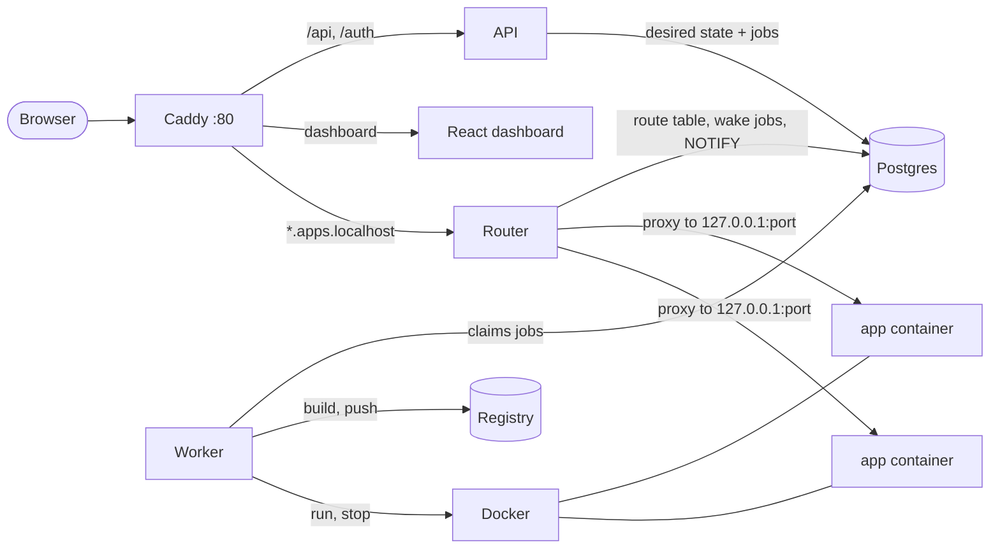

# Shipyard

**Turn a folder of code into a private, shareable web app on its own subdomain, with login, secrets, build logs and scale-to-zero. One machine, `docker compose up`, zero paid services.**

Think "Vercel for internal tools", small enough to read in an afternoon.

> **Status: a local-only demo / portfolio project.** It is not safe to host for other people yet. See [Known limitations](#known-limitations).

<!-- DEMO:START -->
Demo video: _link coming soon_
<!-- DEMO:END -->

## The problem

Someone writes a small tool (a Flask dashboard, a Node script with a UI, a static site) and wants a team-mate to open it. Today that means a cloud account, a Dockerfile, DNS, a login system and a bill, or an `ngrok` link that anyone can open. Shipyard does the boring part: upload the code, get `<name>.apps.<your-domain>`, decide who may open it.

## What it does

- **Deploy from an archive.** Upload a `.zip` (right-click your folder and compress it) or a `.tar.gz` (Python, Node or static, detected automatically, optional `shipyard.toml`). A single wrapper folder inside the zip is removed automatically. It is built from a fixed Dockerfile template, pushed to a local registry, started, health-checked and routed. A redeploy keeps serving the old version until the new one is healthy.
- **Private by default.** Only the owner and invited e-mail addresses can open an app (login handoff, below). Or make it public.
- **Secrets.** Environment variables and secrets, encrypted at rest (AES-256-GCM), never shown again after you save them, injected when the app starts.
- **Live build logs** streamed to the dashboard over SSE.
- **Scale to zero.** Idle apps stop their container and wake on the next request in about 0.6 s (measured).
- **A 4-page dashboard:** login/sign-up, apps list, new app, app detail (overview, access, settings).
- **Hardened containers.** Every app runs as a non-root user with all capabilities dropped, a read-only root filesystem, memory/CPU/PID limits, and no Docker socket.

## Architecture



One Go binary (`cmd/shipyard`) runs as `api`, `worker`, `router` or `migrate`. **Postgres is the only coordination layer:** it holds the data, the job queue (`SELECT … FOR UPDATE SKIP LOCKED` with leases), and pub/sub (`NOTIFY route_changes`), so there is no Redis or message broker. The API never touches Docker: it records desired state and enqueues jobs, and the worker makes reality match.

For this demo the worker and router run on the host and proxy to each app's loopback port (Docker Desktop on Windows cannot reach container IPs from the host). A network-only layout, where apps are reachable only through the router, is deferred (see the limitations).

### How the login handoff works

Apps live on other subdomains, so the dashboard session cookie must never reach them. Instead:

1. A visitor opens a private app. The router sees no valid `_sy_app` cookie and redirects to `shipyard.localhost/auth/app?app=<slug>`.
2. The dashboard session identifies the user and the access check runs (owner, member by e-mail, or public). It creates a **one-time code** (256 random bits, stored only as a SHA-256 hash, valid 60 s, bound to that app) and redirects to the app's host.
3. The router consumes the code atomically (a single `UPDATE … WHERE used_at IS NULL … RETURNING`) and sets `_sy_app`: an HMAC-signed claim bound to **that app**, host-only, `HttpOnly`, 12 h. A cookie for app A is rejected on app B.
4. On every request the router verifies the cookie, re-checks access (cached for 60 s), **strips** `_sy_app` and every incoming `X-Shipyard-*` header, and adds trusted `X-Shipyard-User-Id` / `X-Shipyard-User-Email` headers. The app never sees a session cookie and cannot be fooled by a client that sends its own identity headers.

### How scale to zero works

- The worker's reaper runs every 30 s. A running app whose last request (and container start) is older than its idle timeout gets a `sleep` job; the job re-checks and stops the container but keeps the deploy and the image, so the app is `sleeping`, not stopped.
- The next authorised request makes the router enqueue **one** `launch` job per app (many concurrent requests share the same wake), then wait for the route to turn `running` (announced by `NOTIFY route_changes`). The wait is capped at 30 s and at 100 waiting requests per app (then `503` + `Retry-After`).
- A browser that waits more than 1.5 s gets a "Waking up…" page that polls `/__shipyard/ready` and reloads. The dashboard shows the last wake time.
- A test proves it: 50 concurrent requests to a sleeping app start it exactly once.

## Measured numbers

All numbers come from `make bench` (see [`scripts/bench`](scripts/bench)) on one laptop: AMD Ryzen (family 25, 12 threads), Windows 11, Docker Desktop (VM with 12 CPUs and 7 GiB), Go 1.27, k6 2.2. The load generator runs on the same machine as the router, so treat them as a floor, not a Linux-server benchmark. The router ran with `GOMAXPROCS=1` for the throughput figure.

| Metric | Target | Measured |
|---|---|---|
| Cold start, sleeping app to first byte (static app, n=20) | p50 < 2 s, p95 < 4 s | **p50 611 ms, p95 636 ms** (router-side: 605 / 616 ms) |
| Proxy overhead, warm app, 200 req/s | p95 < 5 ms added | **p50 +0.49 ms, p95 +0.25 ms** (router vs. direct to the app) |
| Router throughput, 1 core, 50 virtual users | ≥ 2,000 req/s | **2,192 req/s** (direct to the app: 2,521) |
| Dashboard API (`/me` + `/apps` through Caddy) | p95 < 200 ms | **p95 3.6 ms** |
| Deploy time, small Python app (Flask), upload to live | p50 < 45 s, p95 < 90 s | **p50 22.7 s, p95 22.9 s** (n=5, base images already pulled) |
| Concurrent wake, 50 requests to a sleeping app | 1 start | **1 start** (integration test and a real run) |

Notes: the cold start measures a static (Caddy) app, so a Python or Node app adds its own start-up time; a sleeping Node app (`whoami`) answered in about 0.8 s in manual checks. Proxy overhead is over loopback without the Caddy hop. Reproduce with `make bench` (needs the stack, a worker and a router running).

## Quick start

Prerequisites: **Docker** (Docker Desktop or Engine), **Go 1.26+**, **Node 22+**, **make**. Free ports: 80, 5000, 5434, 5173, 8081. `*.localhost` resolves to your machine in modern browsers and OSes, so no DNS setup is needed.

```bash
git clone https://github.com/Uzair-23/shipyard.git
cd shipyard

# 1. Postgres, apps database, registry, API (migrations run automatically) and Caddy
docker compose up -d --build

# 2. In their own terminals, from the repo root:
make worker        # builds and starts apps, runs the idle reaper
make router        # serves *.apps.localhost

# 3. The dashboard
cd web && npm ci && npm run dev
```

Open **http://shipyard.localhost** (not `localhost:5173`: the login cookie and the API's origin check expect that host), sign up, then **New app**.

To try it, pack one of the sample apps and upload it (a `.zip` made by your file manager works too):

```bash
tar -czf whoami.tar.gz -C testdata/apps/whoami .      # prints who is visiting
tar -czf hello.tar.gz  -C testdata/apps/hello-python . # a small Flask app
```

Things to try:

1. Watch the build log, then open the app at `http://<name>.apps.localhost`.
2. Open the **Access** tab, add a team-mate's e-mail, and open the app in a private window as that user. Anyone else sees "No access".
3. In **Settings**, add a secret (for example `DEMO_API_KEY`) and see it in the `whoami` output after the automatic restart. The API never returns it again.
4. Leave the app alone for its idle timeout (5 to 60 minutes, set in Settings). The apps list then shows it as `sleeping`; open it again and it wakes by itself.

Run the tests with `make lint`, `make test`, `make test-integration` (real Postgres and Docker through testcontainers) and `make test-security`. CI runs the same on every push.

## Tech

Go (`chi`, `pgx`, `sqlc`, `goose`, `log/slog`, Docker SDK), PostgreSQL 16, Docker, Caddy, React + TypeScript + Vite + TanStack Query + Tailwind. Everything is free and open source.

```text
cmd/shipyard/     one binary: api | worker | router | migrate
internal/         api, auth, access, apps (pipeline), build (templates, upload validation),
                  runtime (hardened containers), router, jobs (queue), secrets, store (sqlc)
migrations/       goose SQL        queries/    sqlc SQL
web/              the dashboard    scripts/bench/  the benchmarks
security/         attack tests for uploads        testdata/apps/  sample apps
```

## Known limitations

Be honest about what this is: a working demo on one machine, not a service to hand to other people.

- **Local only.** Not safe to host for other users yet. App containers publish a port on `127.0.0.1`, so something on the machine can reach an app without going through the router; the per-app network design is deferred.
- **Builds can reach the network and the host.** `pip install` and `npm install` run user code with network access, including services on the host (for example the dev Postgres through `host.docker.internal`). Fix before anyone else deploys: firewall rules or an allow-listing proxy.
- **Default development passwords.** Compose falls back to a well-known database password; require strong ones before sharing the instance.
- **No quotas or abuse limits.** No cap on apps per user, no per-user rate limits, no source or image garbage collection, no free-disk guard. A deploy loop can fill the disk.
- **gVisor is used only if installed;** otherwise the hardened `runc` profile is used and a warning is logged.
- **Uploads are `.zip` or `.tar.gz`,** limited to 50 MB, 5,000 files, printable-ASCII file names, no encrypted zips; templates only (Python, Node, static), no custom Dockerfiles.
- **No stored runtime logs** (only build logs), no crash back-off, no zero-downtime guarantees beyond "the old version serves until the new one is healthy", no rollback UI.
- **Plain HTTP,** no TLS in the local setup; no password reset, e-mail verification or login rate limiting.
- **Sign-up reveals whether an e-mail is registered** (it answers 409), and a master key lost from `data/master.key` makes stored variables unreadable (back it up, or set `SHIPYARD_MASTER_KEY`).
- **Tested on Windows 11 with Docker Desktop only.** CI runs the Go tests (including the Docker integration tests) on Linux, but nobody has run the whole compose stack on Linux yet; the API container (uid 65532) may need write access to `./data` there.
- The benchmark numbers come from one Windows laptop, see above.

## What's next

Security hardening first (per-app networks, build egress control, quotas, gVisor required), then a drift reconciler, stored searchable logs, a CLI, zero-downtime deploys and rollback, per-app databases, Git deploys, and a public demo VM.
